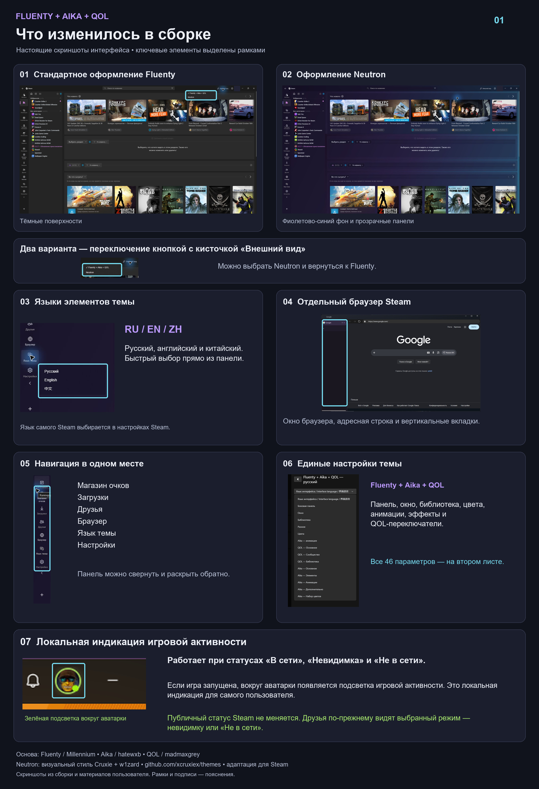
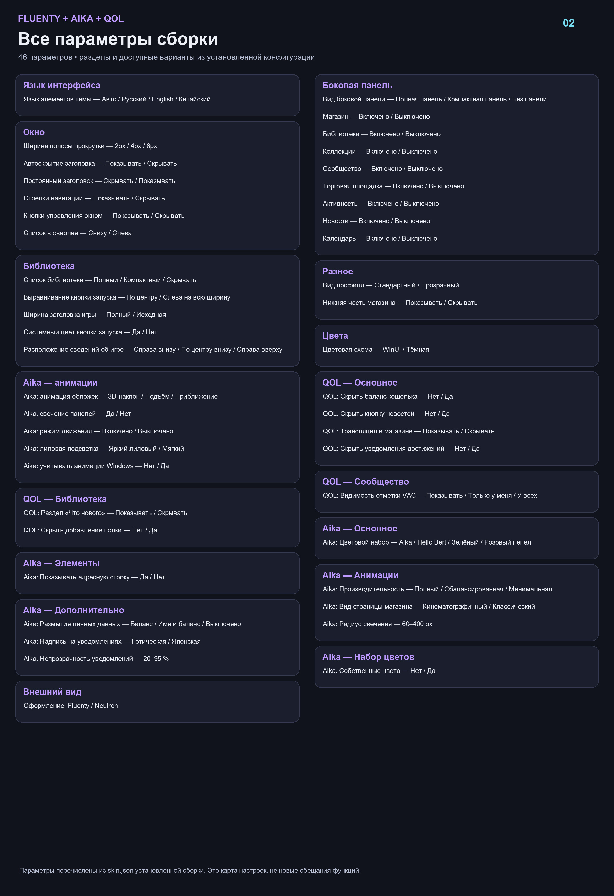

# Fluenty + Aika + QOL: integration for maintainer review

This is the source contribution behind the combined local Steam theme discussed with hatewxb. It is submitted as an additive, opt-in integration, leaving Aika's default entry points and identity unchanged. The maintainer can review the adapter code and decide which changes should become native Aika features.

## Included

- A combined settings generator with single ownership for overlapping QOL visibility switches.
- Fluenty / Neutron-inspired appearance selection and theme-only RU / EN / CN controls.
- Sidebar shortcuts, standalone Steam browser access and browser tab controls.
- Local running-game indication around the user's own avatar, independent of Steam presence. It does not set persona state or make Invisible/Offline users appear Online.
- Compatibility adjustments for Aika effects and Steam's current class aliases.

## Offline review build

Requires Node.js 20+ and existing, independently obtained local copies of Fluenty 1.17.0, Aika 0.1.4 and QOL Toggles Steam. Steam's local `steamui/sp.js` supplies class aliases. No packages or network access are needed.

```powershell
node build-review.cjs --fluenty "X:/themes/fluenty1.17.0" --aika "X:/themes/Aika" --qol "X:/themes/QOL-Toggles-Steam" --steam-ui "X:/Steam/steamui/sp.js" --out "X:/review-output"
```

Run from this directory. The output path must not exist and must be separate from the inputs. All transformations occur on copies inside that output directory. The builder never reads the user's Millennium account configuration, changes installed themes, activates a theme, restarts Steam, or downloads dependencies. The output includes `themes/Fluenty-Aika-QOL-RU`; installation and activation are manual.

The three pipeline stages (`build.cjs`, `enhance.cjs`, `integrate-all.cjs`) are internal. Always invoke `build-review.cjs`. The output contains local input assets and is not intended to be republished without the corresponding authors' permissions.

## Scope and limits

The local integration was exercised on Windows Steam/Millennium. Screenshot-confirmed behavior includes switching appearances, theme language controls, sidebar collapse/restore and the browser window. The user confirmed local game-activity indication; a fresh complete Online/Invisible/Offline launch/close recording is not included. Automated fixture checks are not a substitute for live Steam verification.

Theme localization does not replace Steam's localization; some captions still need translation. Scroll flicker remains reported and must not be advertised as fixed. Tray/restart, every notification type, overlay and all Neutron surfaces need broader verification. This review version retains the locally supplied Fluenty navigation implementation rather than redistributing its modified source.

## Credits

- Aika: hatewxb — https://github.com/hatewxb/Aika
- Fluenty: Millennium / SteamClientHomebrew — https://steambrew.app/fluenty-steam
- QOL Toggles Steam: madmaxgrey (also credits SpaceEnergy) — https://github.com/madmaxgrey/QOL-Toggles-Steam
- Neutron visual inspiration: Cruxie + w1zard — https://github.com/xcruxiex/themes and https://betterdiscord.app/themes/Neutron

No Fluenty/QOL distribution or original Neutron CSS/assets are committed here. Those inputs stay local. Existing upstream Aika credits and bundled third-party notices are preserved. Integration developed with AI assistance.

## Visual index



